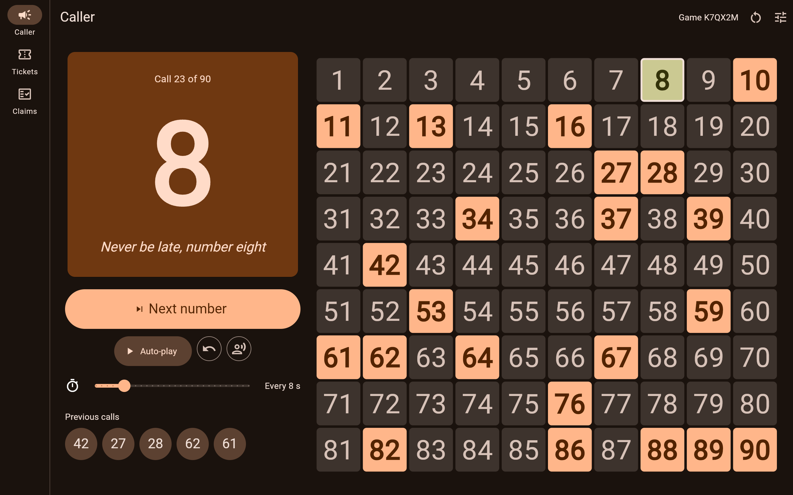
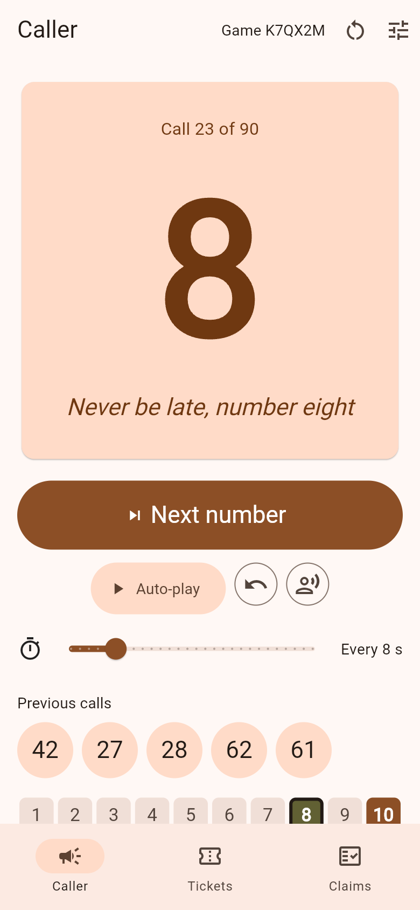
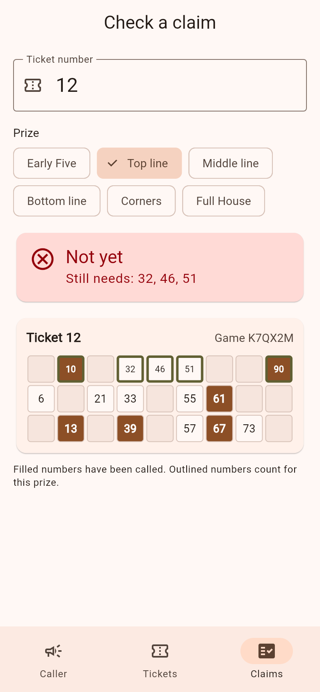
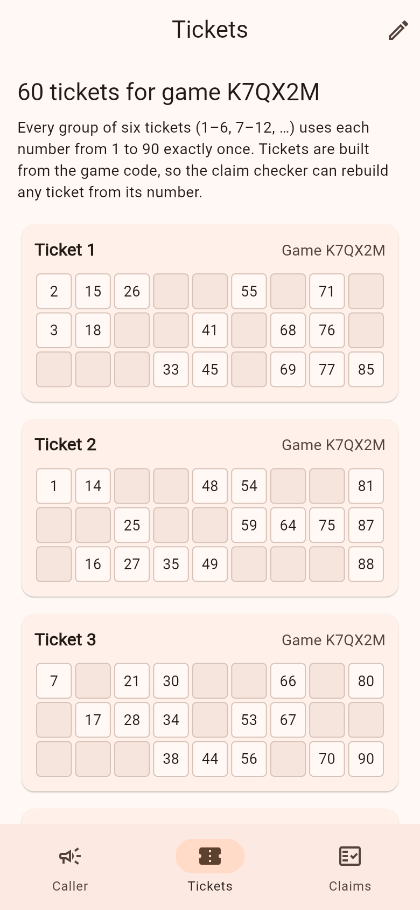

# Tambola Host

[](https://github.com/ChandraChaan/tambola-host/actions/workflows/ci.yml)
[](https://chandrachaan.github.io/tambola-host/)
[](https://flutter.dev)
[](LICENSE)

Everything you need to run a **Tambola / Housie** night from one phone or a
laptop plugged into the TV: a number caller that speaks in English or Hindi,
tickets you can print, and a claim checker that tells you in a second whether
"Full House!" is real.

**▶ Open it: <https://chandrachaan.github.io/tambola-host/>**. No sign-up,
no ads, nothing to install.



<p align="center">
  
  
  
</p>

## What it does

**Caller**
- Draws 1–90 with no repeats. The big number is readable from across the room.
- 1–90 board with every called number filled in, plus the previous five calls.
- **Next** for manual calling, or **Auto-play** every 3–30 seconds, with pause.
- **Undo** the last call if you pressed Next by mistake. Next gives the same
  number back, so nothing is lost.
- Calls numbers aloud in **English** or **Hindi** ("चार और दो, बयालीस"), with an
  optional rhyming call for every number ("Forty-two, peek-a-boo"). The 90
  rhymes were written for this app.

**Tickets**
- Valid tickets every time: 3 rows × 9 columns, 15 numbers, 5 per row, every
  column used, column ranges 1–9, 10–19 … 80–90, ascending down each column.
- Tickets come in **strips of six that use all 90 numbers exactly once**, like
  the printed books.
- Each ticket shows its number and the game code.
- **Print or save as PDF** from the Tickets tab: one strip of six tickets per
  A4 page, with dashed lines to cut along.

**Claim checker**
- Type the ticket number, pick the prize (Early Five, Top / Middle / Bottom line,
  Corners, Full House) and see the ticket with called numbers marked.
- Tells you if the claim is valid, which call completed it, and whether it was
  already complete a few calls ago (for house rules about late claims).
- If it's not valid yet, it lists the numbers still missing.

**Everywhere**
- The game is saved in the browser as you go, so a refresh or a closed tab
  loses nothing.
- Light, dark or automatic theme; phone layout or a side-by-side TV layout.
- Android build from the same code.

## How to run a game

1. Open the app on the device you'll call from. A new game with a six-letter
   **game code** (for example `K7QX2M`) is ready.
2. **Tickets** tab: set how many tickets you need, tap the printer icon to
   print them (or save the PDF and share it), and hand them out.
3. **Caller** tab: press **Next number** for each call, or **Auto-play** and
   set the speed. Turn on voice and rhymes under **Settings** (the sliders icon).
   On a TV, connect a laptop and make the browser full-screen.
4. When someone shouts a claim, open **Claims**, type their ticket number, pick
   the prize, and read out the verdict.
5. To play again with the same printed tickets, tap **New game** and type the
   same game code. You get the same tickets and a fresh, unpredictable call order.

## How tickets and calls are made

- **Tickets come from the game code.** Ticket *n* belongs to strip
  `(n - 1) / 6`, and each strip is generated from a seed made from the game
  code and the strip number. The same code always gives the same tickets on
  every device, which is how the claim checker can rebuild any ticket from its
  number alone.
- **The call order doesn't.** It comes from a separate random seed that never
  leaves the host's device, so a player who knows the game code (it's printed
  on their ticket) still can't predict the calls.
- The random generator is a small 32-bit one written to give identical results
  on Android and in the browser. A test pins a known ticket so tickets that
  are already printed keep matching after updates.

## Privacy

Everything stays in your browser (or on your phone). There are no accounts,
no servers, no analytics and no cookies. The game and your settings are kept in
local storage on your device. Voice calling uses your browser's or phone's own
text-to-speech voices.

## Run it yourself

You need [Flutter](https://docs.flutter.dev/get-started/install) 3.44 or newer.

```bash
git clone https://github.com/ChandraChaan/tambola-host.git
cd tambola-host
flutter pub get
flutter run -d chrome        # or: flutter run (Android)
```

Checks that CI runs on every push:

```bash
dart format --output=none --set-exit-if-changed lib test
flutter analyze
flutter test
```

The tests cover ticket validity across thousands of seeds, strip completeness,
every claim rule, the caller never repeating, seed determinism (including a
pinned ticket), saved-game handling, and widget tests for calling, auto-play,
undo, new games, tickets and claims.

### Project layout

```
lib/
  core/                     seeded random, theme, router
  features/game/domain/     tickets, strips, calls, claim rules (pure Dart)
  features/game/data/       shared_preferences storage, text-to-speech
  features/game/presentation/  Riverpod controllers
  features/caller|tickets|claims|shell/presentation/  screens
```

## Contributing

Issues and pull requests are welcome, especially rhymes and number words in
more Indian languages, prize variants your family plays, and accessibility
fixes. Please run the three checks above before opening a PR.

## License

[MIT](LICENSE) © Chandra ObulaReddy
